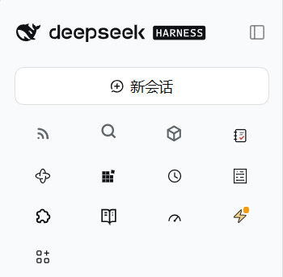
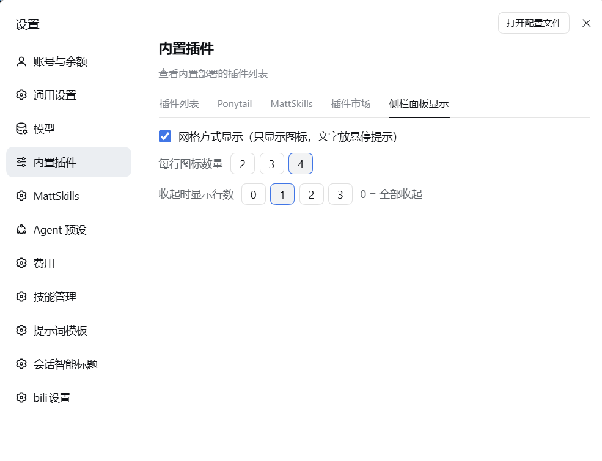
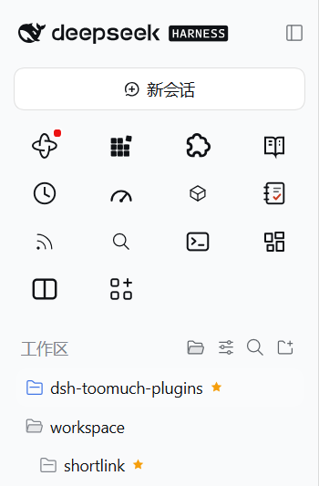
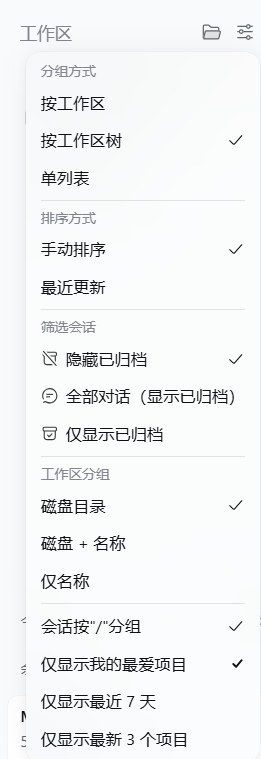
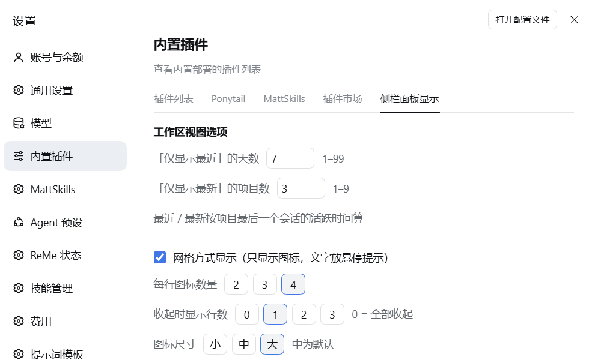

<div align="center">

# dsh-toomuch-plugins

**Makes room in the DSH Web sidebar.** · *Too many plugins, too little room.*

[](https://github.com/rivenshanghai/dsh-toomuch-plugins/blob/main/LICENSE)
[](https://www.npmjs.com/package/dsh-toomuch-plugins)
[](https://nodejs.org)
[](https://github.com/rivenshanghai/dsh-toomuch-plugins)
[](https://github.com/topics/dsh-plugin)

[English](README.md) | [简体中文](README.zh-CN.md)

</div>

---

A small plugin set that gives the [DeepSeek Harness](https://github.com/deepseek-ai/deepseek-harness)
(DSH) Web sidebar some breathing room.

It ships one plugin today:

| Plugin | What it does |
| --- | --- |
| Sidebar panel collapse | Collapses the "global panels" column above the workspace into one toggle in the sidebar footer; the settings page in the left nav tunes entry display and the project filters (last n days / latest m) |
| Workspace favorites and filters | Star projects from their context menu (a yellow star in the sidebar) and filter the project list by favorites / recency |

## Why

The DSH Web sidebar stacks, from top to bottom: brand row → new session → **global
panel entries** → workspace → settings.

Every plugin that adds a sidebar entry adds a row to that column: plugins, plugin
market, schedules, MCP studio, context, skill manager, system monitor… Seven rows
are roughly 280px, which squeezes the workspace region down to a few sessions.

This plugin does exactly one thing: **collapse that column of global panel
entries**, and bring it back when you need it.

## Highlights

- **Collapsed by default** — the workspace gets ~280px back as soon as the plugin
  is installed.
- **One toggle** in the sidebar footer, right above "settings".
- **Remembered** in `localStorage`; survives reloads and restarts.
- **Nothing else is touched** — no panel, no workspace, no host behaviour; only
  the display of the list element the sidebar already renders.
- **Themed** with `--dsw-alias-*` tokens only, so it follows the DSH theme.
- **Rail-friendly** — in the narrow 56px rail the toggle becomes a round icon button.
- **Grid display** — in Settings (left nav → Sidebar panel display), switch the entry list to icons
  only (panel names become hover tooltips) with 2–4 icons per row. Bundles that skip
  the panel-list slot and inject their own sidebar buttons (the `data-dsh-*-entry`
  convention, e.g. 今日值得读 / 全局搜索 / 容器) are adopted into the grid too, and
  put back in place when the grid turns off.
- **Keep some entries while collapsed** — list mode keeps the first 0–5 entries
  visible while the panels are collapsed; grid mode keeps the first 0–3 rows
  (rows × icons). Default 0, i.e. everything collapsed.
- **Plugin display order** — pick panels one by one from a dropdown on the
  settings page; the list order is the sidebar order (lossless CSS `order`
  overrides). Capped at 20, duplicates dropped on save. The dropdown also
  lists slot-skipping sidebar entries (今日值得读 / 全局搜索 / 容器 and other
  `data-dsh-*-entry` followers); listed ones are adopted into the list so the
  order really applies, and released when the order is cleared.
- **Click counting** — panel clicks accumulate into
  `~/.dsh/plugins/dsh-toomuch-plugins/click-counts.json`, (silently skipped when the remote is unavailable).
- **Plugin activity log** — an icon right of the "collapse / expand global panels" toggle opens a
  window with two tabs: **Install / remove** (every record) and **Enable / disable** (the last
  month), written to `~/.dsh/plugins/dsh-toomuch-plugins/plugin-history.json`. Records are built
  by comparing the profile manifest with the state the log recorded last time, not by listening for
  change events: plugins are installed and removed from the settings panel, from the plugin market
  and from the `dsh` CLI, and only the first of those announces what it did. **Upgrades are left
  out**: DSH upgrades by removing the package and installing it again, so a package that reappears
  with another version retracts the removal it started with. Each row shows the action as a 16px
  stroke icon rather than text, coloured by state — **install and enable are green** (the power
  symbol), **remove and disable are red** (the power symbol with a bar through it) — and the
  plugin name and the time are set larger than the body text. Both tabs are returned newest first.
- **First run lists nothing** — the plugins a profile already has were installed before this log
  existed, so they are not news: the window starts empty and the current state becomes the
  baseline the next comparison starts from. Only what happens afterwards is a record.
- **Icon size** — pick small (12px), medium (the sidebar's own size, the
  default) or large (24px); the list and grid icons scale right away and the
  choice survives reloads.
- **My favorites** — the **first line** of a project's context menu is 「我的最爱」
  (ahead of 重命名): click to star, click again to unstar. The menu icon switches
  between a filled and an outline star. A starred project shows a **yellow star**
  after its name in the sidebar — always visible, not hover-only.
- **Stars follow the DSH home** — they live in the plugin's own file
  (`~/.dsh/plugins/dsh-toomuch-plugins/favorites.json`), keyed by the project's
  **absolute path**: deleting a workspace and adding the same directory back keeps
  the star, and the stars survive a browser change or a machine change.
- **Three project filters** — the view-options icon in the workspace region gains
  three switches at the end of its 「筛选会话」 group: **only my favorite
  projects**, **only the last n days** (7 by default) and **only the latest m
  projects** (3 by default). Each shows a check mark when on and none when off,
  and clicking a switch does **not** close the menu (so you can turn on two in a
  row). Projects that do not pass are hidden outright, together with their
  sessions; the flat view and search results behave the same.
- **Recent / latest follow activity** — each project's **last session activity**,
  not how long ago the project was added: a project registered three months ago
  but used yesterday counts as recent.
- **The filters combine with AND** — turning on both "only my favorites" and
  "only the last 7 days" leaves only the projects that are starred *and* active in
  the past week. In the nested workspace tree, a qualifying child project brings
  its **parent directory** along, so the child is never an orphan row; the parent
  is only a container and its own sessions stay hidden.
- **The two numbers sit at the top of the settings page** — a 「工作区视图选项」
  group in the 「侧栏面板显示」 section (Settings left nav): the days for
  "only the last n days" (1–99) and the project count for "only the latest m
  projects" (1–9).
- **Off by default** — grid mode is opt-in; the preference lives in `localStorage`
  alongside the collapse state and survives reloads.
- **Works with DSH v0.2.2-rc.2** — that release moved the global-panel list into
  the sidebar's scroll viewport, so it now scrolls together with the workspace
  region. The list is found structurally, in the old and the new shape alike, and
  the collapsed limit counts whole cells — so the grid keeps no empty cell per
  hidden row. DSH's hover-only 「从左侧栏取消固定」 button is hidden in grid mode
  (it would sit on top of the icons); the list mode keeps it.

## Screenshots

Grid display — icons only, panel names as hover tooltips, 2–4 icons per row:



The "Sidebar panel display" settings page (Settings left nav) — grid
mode, icons per row, and how many rows stay visible while collapsed:



New in 0.4.0 — a starred project in the sidebar (the yellow star after its name):



The three filter switches at the end of the view-options menu:



The 「工作区视图选项」 group at the top of the settings page:



## Install

The plugin is a repository-root package: it declares the `dsh.bundle` manifest, so
DSH can install it straight from npm or GitHub.

```sh
# from npm (prebuilt — no build approval step)
dsh plugin --profile web add dsh-toomuch-plugins

# from GitHub
dsh plugin --profile web add github:rivenshanghai/dsh-toomuch-plugins

# or from a local clone
git clone https://github.com/rivenshanghai/dsh-toomuch-plugins.git
dsh plugin --profile web add /path/to/dsh-toomuch-plugins
```

`dsh plugin` forwards to `pnpm` inside the profile. After the install, **enable the
plugin** in DSH's plugin settings (it is written into the profile's
`dsh.profile.bundles`), then refresh the page.

From the plugin market, once listed: open **Settings → Plugin Market** in DSH and
search for `dsh-toomuch-plugins`.

**Verify:** the sidebar footer gains a "Collapse global panels / Expand global
panels" row above "settings", and the global panel column is gone. Settings
(left nav) gains a "Sidebar panel display" page for grid mode,
icons-per-row, how many entries (list) or rows (grid) stay visible while
collapsed, the custom plugin display order (up to 20 entries), and the icon
size (small / medium / large).

For 0.4.0: right-click a project — the **first line** of the menu is 「我的最爱」,
and clicking it puts a yellow star after the project name. The view-options icon
in the workspace region gains three switches at the end of its 「筛选会话」 group,
and the settings page opens with a 「工作区视图选项」 group.

Requirements: DSH (DeepSeek Harness) with a `web` profile; Node.js ≥ 20.

## How it works

`src/client.js` does the following:

1. registers a toggle into the sidebar footer slot `sidebar.footer.action` (the
   row next to "settings");
2. walks up from its own root node to find the sidebar root's direct `<nav>` child —
   the global panel list — and toggles its `display`;
3. remembers the choice in `localStorage`;
4. registers a settings page through the `settings.section` slot (the Settings left
   nav rail) where grid mode, the 2–4 icons-per-row choice and the
   three icon sizes (small / medium / large) live;
5. applies grid mode to the same `<nav>`: a marker class plus a columns CSS
   variable, the label span hidden, and each entry's `aria-label` mirrored into
   the native `title` as the hover tooltip (DSH's own tooltip is disabled in the
   wide sidebar, and the label is not rendered there either);
6. applies the custom display order as CSS `order` overrides on the `<nav>`'s
   direct children (lossless — React's DOM reconciliation is never fought), and
   makes the collapsed limit keep the first N entries *visually*;
7. mounts a hand-rolled Typert remote contribution (the dsh-cost-meter pattern)
   and reports panel clicks to the host half, which accumulates them into
   `click-counts.json` ;
8. draws a clock icon right of the toggle; clicking it opens the activity
   window (registered in the `shell.overlay` slot, so it floats over the app
   instead of being clipped by the sidebar) with an 「安装/删除」 and an
   「启用/禁用」 tab, fed by the host half's `spcHistory.list`;
9. registers a `ctx.contextMenus` contribution (`target: 'workspace'`, order 50,
   ahead of the host's 重命名) so 「我的最爱」 is the first line of the project
   context menu, and draws a yellow star next to the name of a starred project;
10. clones three of the host's own menu rows into the host's view-options menu as
    the filter switches (height, hover state and theme colours follow the host),
    and marks the project and session rows that do not pass for hiding.

The host half (`src/index.js`) provides three services:

- `spcClicks` — the click counts described above;
- `spcHistory` — the plugin activity log. `src/history.js` compares the profile
  manifest with the state it recorded last time and writes the differences down:
  the plugin name, the time and the action. It recognises an upgrade by the
  version that disappears and comes back, so an upgrade leaves no record. The
  log lives in `plugin-history.json` next to `click-counts.json`;
- `spcFavorites` — the workspace favorites. `src/favorites.js` reads and writes
  `favorites.json` (keyed by the project's absolute path, written atomically);
  the client only asks the host to toggle a path and gets the full list back.

The workspace rows are matched **by id, not by key prefix** (the host has changed
it before): the row key ends with the id, so the tail is matched instead. The
element holding the project name is recognised by shape — the first element with
text of its own and no child elements.

The basis is DSH's own `@deepseek-ai/dsh-client-ui-sidebar`: `nav.panelList` is a
direct child of the sidebar root, so walking up from the footer button always
reaches it. Styling uses only `--dsw-alias-*` theme variables, and the stylesheet
rides inside the component, so unmounting removes it.

No DSH internal package is imported, and no DSH file is modified. The full
contract is written down in [docs/design.md](docs/design.md).

## Repository layout

```
.
├── package.json            plugin manifest: dsh.bundle.patch + dsh.client
├── cordis.patch.yml        inserts the loader row into the profile
├── src/
│   ├── index.js            Host half: spcClicks / spcHistory / spcFavorites remote services
│   ├── history.js          Host half: the activity recorder → plugin-history.json
│   ├── favorites.js        Host half: the workspace favorites → favorites.json (atomic write)
│   └── client.js           Client half: footer toggle + collapse/expand + grid + display order + click reporting + activity window + favorites and filters
├── test/smoke.js           zero-dependency smoke check (node test/smoke.js)
├── test/star-layout.mjs    browser regression: star placement and recovery after a host re-render
├── test/filter-menu.mjs    browser regression: the three filter switches
├── test/filter-rows.mjs    browser regression: hiding project and session rows
├── locale/{en,zh}.json     title and description in the plugin list
├── docs/                   design notes, market submission, pre-submit checklist
├── icon.svg                icon
├── CHANGELOG.md
└── LICENSE
```

## Known limits

- It collapses the **global panel entries** column only. The brand row, new
  session and settings are left alone — the brand row's "collapse sidebar" button
  is the only entry point on Linux / Windows, so hiding it would lose a feature.
- With no global panels installed, the sidebar never renders that `<nav>` and the
  toggle is a harmless no-op.
- The workspace side (favorites and filters) relies on the shape of the host's
  project rows. If a DSH release changes that shape, the worst case is that
  **the star and the three switches do not appear** — everything else keeps
  working, the same safe failure as the panel list.
- Verified on DSH Web (Linux) only.

## Plugin market

DSH plugins are listed in the
[awesome-dsh-plugin](https://github.com/awesome-dsh-plugin/awesome-dsh-plugin)
catalog, which aggregates the repositories carrying the **`dsh-plugin`** GitHub
topic. Add that topic to this repository, then open a one-file pull request
against that catalog: the entry file is `data/plugins/<owner>__<repo>.yml`,
with a `category`, a one-line `description.en` and an optional `description.zh`
(the catalog's contributing guide has the exact rules).

## Related plugins

- [dsh-sidebar-quiet](https://www.npmjs.com/package/dsh-sidebar-quiet) — folds the sidebar **footer** rows (balance / import / memory / sign out) into one line
- [dsh-sidebar-buttons](https://github.com/lywusichen/dsh-sidebar-buttons) — manage sidebar footer buttons: drag to reorder, show / fold into More / hide
- [dsh-sidebar-pins](https://github.com/AndreyTepaykin/dsh-sidebar-pins) — a collapsible pinned-sessions block above the settings row
- [dsh-sidebar-drawer](https://github.com/1dustycy/dsh-sidebar-drawer) — an edge-hover drawer that expands the sidebar
- [dsh-plugin-sidebar-visibility](https://github.com/Robert-Wang-08/dsh-plugin-sidebar-visibility) — hide / collapse at the workspace level

## Contributing

Bug reports and pull requests are welcome. Please include your DSH version, the
browser, and whether the toggle appeared in the sidebar footer. Keep the change
focused: this plugin does one thing, and the DOM contract it relies on is
documented in [docs/design.md](docs/design.md).

## License

MIT © [rivenshanghai](https://github.com/rivenshanghai) — see [LICENSE](LICENSE).
