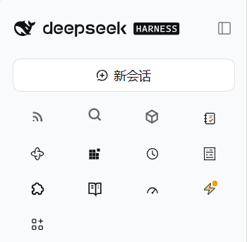
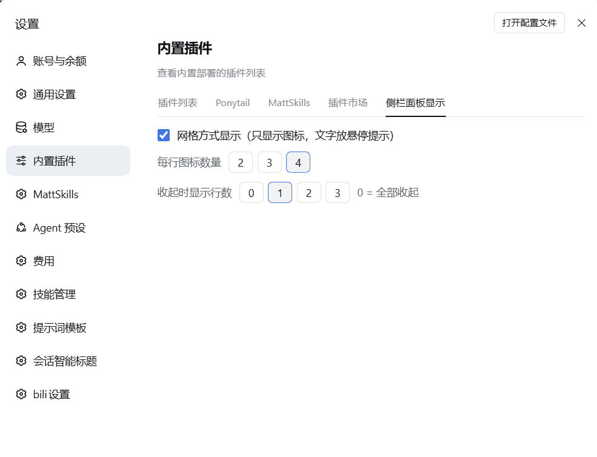

<div align="center">

# dsh-toomuch-plugins

**给 DSH Web 侧栏腾点地方。** · *Too many plugins, too little room.*

[](https://github.com/rivenshanghai/dsh-toomuch-plugins/blob/main/LICENSE)
[](https://www.npmjs.com/package/dsh-toomuch-plugins)
[](https://nodejs.org)
[](https://github.com/rivenshanghai/dsh-toomuch-plugins)
[](https://github.com/topics/dsh-plugin)

[English](README.md) | [简体中文](README.zh-CN.md)

</div>

---

给 [DeepSeek Harness](https://github.com/deepseek-ai/deepseek-harness)（DSH）Web
侧栏做减法的小插件集。

目前只内置一个插件：

| 插件 | 作用 |
| --- | --- |
| 侧栏面板收起 | 把工作区上方的「全局面板入口」列收成侧栏底部的一个开关；附带网格显示配置页 |

## 为什么

DSH Web 侧栏从上到下依次是：品牌行 → 新会话 → **全局面板入口** → 工作区 → 设置。

每个往侧栏加一项的插件都会在这列里加一行：插件、插件市场、定时任务、MCP
Studio、上下文、技能管理器、系统监控……七行大概 280px，工作区区域被压得只剩几个会话。

这个插件只做一件事：**把这一列全局面板入口收起来**，需要时再展开。

## 特性

- **默认收起** —— 装上之后工作区立刻多出约 280px。
- **只要一个开关** —— 放在侧栏底部，「设置」那一行的上面。
- **记住选择** —— 存在 `localStorage`，刷新、重启都保持。
- **不碰别的东西** —— 不动任何面板、工作区或 Host 行为，只切换侧栏本来就会渲染的那个列表元素的显示状态。
- **跟随主题** —— 只用 `--dsw-alias-*` 主题变量，明暗主题都一致。
- **窄栏友好** —— 侧栏收成 56px rail 时，开关变成一个圆形图标按钮。
- **网格显示** —— 设置 → 内置插件 里开启：入口只显示图标，面板名变成悬停提示；每行 2–4 个图标可调。绕过面板槽、自己往侧栏插按钮的插件（沿用 `data-dsh-*-entry` 约定，如今日值得读 / 全局搜索 / 容器）也会一并纳入网格，关闭时还原原位。
- **收起时保留部分入口** —— 列表模式可设收起后仍显示前 0–5 个入口；网格模式可设仍显示前 0–3 行（行数 × 列数）。默认 0，即全部收起。
- **插件显示顺序** —— 设置页里从下拉框逐个挑选面板，列表顺序即侧栏显示顺序（以无损 CSS `order` 重排）；最多 20 项，重复项保存时自动去掉。下拉框也会列出绕过面板槽、自己插进侧栏的条目（今日值得读 / 全局搜索 / 容器等 `data-dsh-*-entry` 约定的插件）；被列出的会被收养进列表让顺序真正生效，清空后放回原位。
- **点击计数** —— 点击面板入口会把计数累加进 `~/.dsh/plugins/dsh-toomuch-plugins/click-counts.json`，（远程不可用时静默跳过）。
- **图标尺寸** —— 设置页可选 小（12px）/ 中（默认，侧栏原生尺寸）/ 大（24px）三档，
  列表与网格模式下的入口图标立刻缩放，刷新后保持。
- **默认不折腾** —— 网格默认关闭，偏好和折叠状态一样存 `localStorage`，刷新、重启都保持。

## 效果预览

网格显示 —— 只显示图标，面板名放悬停提示，每行 2–4 个图标：



「侧栏面板显示」设置页（设置 → 内置插件）—— 网格开关、每行图标数、收起时显示行数：



## 安装

本插件是「仓库根即包」的形式：根 `package.json` 里就声明了 `dsh.bundle` 清单，
所以 DSH 可以直接从 npm 或 GitHub 安装。

```sh
# 从 npm 安装（预构建，不需要走构建授权）
dsh plugin --profile web add dsh-toomuch-plugins

# 从 GitHub 安装
dsh plugin --profile web add github:rivenshanghai/dsh-toomuch-plugins

# 或者从本地 clone
git clone https://github.com/rivenshanghai/dsh-toomuch-plugins.git
dsh plugin --profile web add /path/to/dsh-toomuch-plugins
```

`dsh plugin` 实际是把参数转交给 profile 里的 `pnpm`。装完之后还要在 DSH 的插件设置里
**启用它**（它会被写进 profile 的 `dsh.profile.bundles`），然后刷新页面。

如果已经被收录进插件市场：在 DSH 里打开 **设置 → 插件市场**，搜索 `dsh-toomuch-plugins`。

**验证方式：** 侧栏底部「设置」上面会多出一行「收起全局面板 / 展开全局面板」，
同时那列全局面板入口消失。**设置 → 内置插件** 里会多出「侧栏面板显示」页，可开关
网格显示、设置每行图标数、收起后仍显示的插件数（列表模式）或行数（网格模式），
以及自定义插件显示顺序（最多 20 项）与图标尺寸三档（小 / 中 / 大）。

环境要求：带 `web` profile 的 DSH（DeepSeek Harness）；Node.js ≥ 20。

## 实现原理

`src/client.js` 做这几件事：

1. 在侧栏底部插槽 `sidebar.footer.action` 注册一个开关按钮（即「设置」旁边那一行）；
2. 从自己的根节点向上回溯，找到侧栏根节点下的直接子元素 `<nav>` —— 那就是全局面板
   列表 —— 切换它的 `display`；
3. 把选择写进 `localStorage`；
4. 通过 `settings.plugins.tab` 槽在 设置 → 内置插件 注册「侧栏面板显示」页，开关
   网格显示、选择每行 2–4 个图标、选择图标尺寸（小 / 中 / 大）；
5. 网格套用：给那个 `<nav>` 加一个标记 class + 列数 CSS 变量，隐藏文字 `span`，并把
   每个入口的 `aria-label` 镜像成原生 `title` 当悬停提示（宽栏下 DSH 自己的 Tooltip
   被禁用，文字也没渲染）；
6. 把自定义显示顺序写成 `<nav>` 直接子元素的 CSS `order` 覆盖（无损重排，不和 React
   的 DOM 调和打架），收起限额按**视觉顺序**保留前 N 个；
7. 挂一份手写 Typert 远程贡献（dsh-cost-meter 同款接线），把面板点击报给 Host 半边，
   由它累加进 `click-counts.json`。

Host 半边（`src/index.js`）只提供 `spcClicks` 这一个服务：原型方法 + 手写
`typertRemote` 绑定，靠 gateway 的 src 描述符兜底接通 —— 不生成清单、不 import
DSH 内部包。

依据是 DSH 自己的 `@deepseek-ai/dsh-client-ui-sidebar`：`nav.panelList` 是侧栏根节点的
直接子元素，所以从底部按钮往上回溯一定能找到它。样式只用 `--dsw-alias-*` 主题变量，
样式表随组件一起挂载，卸载时一并消失。

不 import 任何 DSH 内部包，也不改动 DSH 的任何文件。完整约定见
[docs/design.md](docs/design.md)。

## 目录结构

```
.
├── package.json            插件清单：dsh.bundle.patch + dsh.client
├── cordis.patch.yml        往 profile 里插入插件加载行
├── src/
│   ├── index.js            Host 半边：spcClicks 远程服务 → click-counts.json
│   └── client.js           Client 半边：底部开关 + 收起/展开 + 网格 + 显示顺序 + 点击上报
├── test/smoke.js           零依赖冒烟检查（node test/smoke.js）
├── locale/{en,zh}.json     插件列表里的标题与描述
├── docs/                   设计说明、市场提交、提交前清单
├── icon.svg                图标
├── CHANGELOG.md
└── LICENSE
```

## 已知限制

- 只收起**全局面板入口**这一列。品牌行、新会话、设置都保持原样 —— 在
  Linux / Windows 上品牌行里的「收起侧栏」是唯一的收起入口，把它藏起来等于少一个功能。
- 一个全局面板都没装时，侧栏不会渲染那个 `<nav>`，开关就是个无害的空操作。
- 目前只在 DSH Web（Linux）上验证过。

## 插件市场

DSH 插件收录在 [awesome-dsh-plugin](https://github.com/awesome-dsh-plugin/awesome-dsh-plugin)
目录里，而这个目录聚合的是所有带 **`dsh-plugin`** GitHub topic 的仓库。给本仓库加上这个
topic 之后，往那个目录提一个单文件的 PR 即可：条目文件是
`data/plugins/<owner>__<repo>.yml`，填上 `category`、一行 `description.en` 和可选的
`description.zh`（详细规则见那个仓库的 contributing guide）。

## 相关插件

- [dsh-sidebar-quiet](https://www.npmjs.com/package/dsh-sidebar-quiet) —— 把侧栏**底部**那些行（余额 / 导入 / 记忆 / 退出）折成一行
- [dsh-sidebar-buttons](https://github.com/lywusichen/dsh-sidebar-buttons) —— 管理侧栏底部按钮：拖动排序、显示 / 折进更多 / 隐藏
- [dsh-sidebar-pins](https://github.com/AndreyTepaykin/dsh-sidebar-pins) —— 在设置行上方加一个可收起的置顶会话块
- [dsh-sidebar-drawer](https://github.com/1dustycy/dsh-sidebar-drawer) —— 鼠标贴边悬停即可展开侧栏的抽屉
- [dsh-plugin-sidebar-visibility](https://github.com/Robert-Wang-08/dsh-plugin-sidebar-visibility) —— 在工作区层面隐藏 / 收起

## 参与贡献

欢迎提 issue 和 PR。请附上你的 DSH 版本、浏览器，以及侧栏底部有没有出现开关。改动尽量
聚焦：这个插件只做一件事，它依赖的 DOM 约定写在
[docs/design.md](docs/design.md) 里。

## 许可证

MIT © [rivenshanghai](https://github.com/rivenshanghai) —— 见 [LICENSE](LICENSE)。
