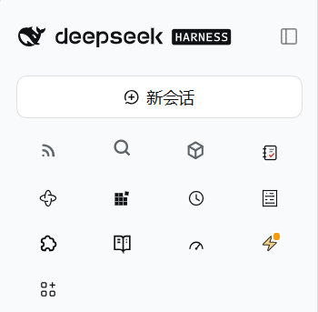
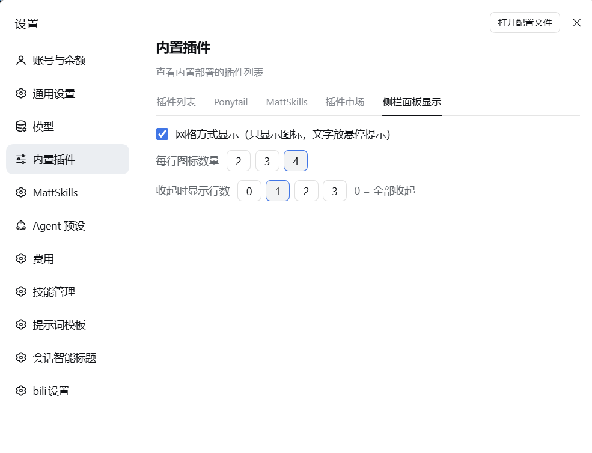
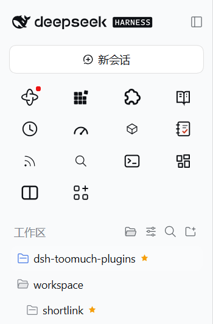
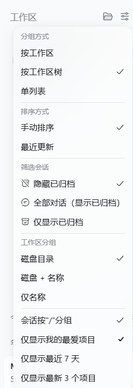
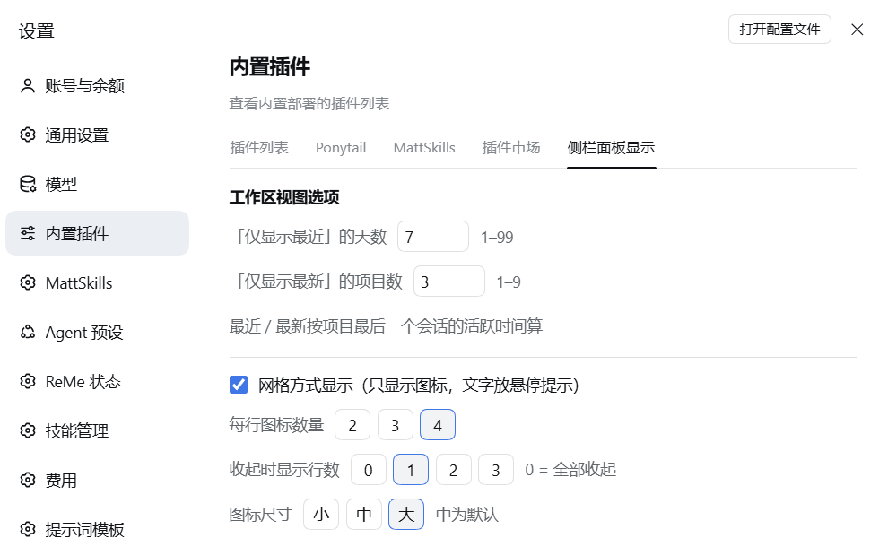

<div align="center">

# dsh-toomuch-plugins

**给 DSH Web 侧栏腾点地方。** · *Too many plugins, too little room.*

[](https://github.com/rivenshanghai/dsh-toomuch-plugins/blob/main/LICENSE)
[](https://www.npmjs.com/package/dsh-toomuch-plugins)
[](https://nodejs.org)
[](https://github.com/rivenshanghai/dsh-toomuch-plugins)
[](https://github.com/topics/dsh-plugin)

[English](README.md) | [简体中文](README.zh-CN.md)

</div>

---

给 [DeepSeek Harness](https://github.com/deepseek-ai/deepseek-harness)（DSH）Web
侧栏做减法的小插件集。

目前只内置一个插件：

| 插件 | 作用 |
| --- | --- |
| 侧栏面板收起 | 把工作区上方的「全局面板入口」列收成侧栏底部的一个开关；附带网格显示配置页 |
| 工作区收藏与筛选 | 项目右键菜单里收藏项目（侧栏带黄星），侧栏「视图选项」里按最爱 / 最近 / 最新筛选项目 |

## 为什么

DSH Web 侧栏从上到下依次是：品牌行 → 新会话 → **全局面板入口** → 工作区 → 设置。

每个往侧栏加一项的插件都会在这列里加一行：插件、插件市场、定时任务、MCP
Studio、上下文、技能管理器、系统监控……七行大概 280px，工作区区域被压得只剩几个会话。

这个插件只做一件事：**把这一列全局面板入口收起来**，需要时再展开。

## 特性

- **默认收起** —— 装上之后工作区立刻多出约 280px。
- **只要一个开关** —— 放在侧栏底部，「设置」那一行的上面。
- **记住选择** —— 存在 `localStorage`，刷新、重启都保持。
- **不碰别的东西** —— 不动任何面板、工作区或 Host 行为，只切换侧栏本来就会渲染的那个列表元素的显示状态。
- **跟随主题** —— 只用 `--dsw-alias-*` 主题变量，明暗主题都一致。
- **窄栏友好** —— 侧栏收成 56px rail 时，开关变成一个圆形图标按钮。
- **网格显示** —— 设置 → 内置插件 里开启：入口只显示图标，面板名变成悬停提示；每行 2–4 个图标可调。绕过面板槽、自己往侧栏插按钮的插件（沿用 `data-dsh-*-entry` 约定，如今日值得读 / 全局搜索 / 容器）也会一并纳入网格，关闭时还原原位。
- **收起时保留部分入口** —— 列表模式可设收起后仍显示前 0–5 个入口；网格模式可设仍显示前 0–3 行（行数 × 列数）。默认 0，即全部收起。
- **插件显示顺序** —— 设置页里从下拉框逐个挑选面板，列表顺序即侧栏显示顺序（以无损 CSS `order` 重排）；最多 20 项，重复项保存时自动去掉。下拉框也会列出绕过面板槽、自己插进侧栏的条目（今日值得读 / 全局搜索 / 容器等 `data-dsh-*-entry` 约定的插件）；被列出的会被收养进列表让顺序真正生效，清空后放回原位。
- **点击计数** —— 点击面板入口会把计数累加进 `~/.dsh/plugins/dsh-toomuch-plugins/click-counts.json`，（远程不可用时静默跳过）。
- **插件操作记录** —— 「收起 / 展开全局面板」按钮右侧多一个图标，点开是带两个标签的窗口：「安装/删除」（全量）与「启用/禁用」（最近一个月），写入 `~/.dsh/plugins/dsh-toomuch-plugins/plugin-history.json`。记录靠**比对 profile 清单**得出，不靠监听变更事件：插件可能在设置页、插件市场或 `dsh` 命令行里被装/删，其中只有设置页那条路会广播自己的动作。**升级不计入**：DSH 的升级就是「先删后装同一个包」，所以换了版本又出现的包会把刚记下的那条删除撤掉。
- **首次运行不罗列插件** —— profile 里已经装着的插件是这份日志存在之前就装上的，不是新闻，所以首次运行时窗口里没有任何记录；当前状态直接成为之后比对的基线，只有之后的装/删/启停才是记录。
- **操作列为图标、按时间倒序** —— 操作列不再用文字写「安装 / 删除 / 启用 / 禁用」（行高下看不清），改为 16px 线条图标并按状态色着色：**安装、启用是绿色**（电源符号），**删除、禁用是红色**（电源符号加一道斜杠），并给屏幕阅读器留 `aria-label`；插件名 14px 半粗、时间 13px，都比正文大一号；两个标签页都按时间倒序返回。
- **图标尺寸** —— 设置页可选 小（12px）/ 中（默认，侧栏原生尺寸）/ 大（24px）三档，
  列表与网格模式下的入口图标立刻缩放，刷新后保持。
- **我的最爱** —— 项目行的右键菜单**第一行**就是「我的最爱」（排在「重命名」之前），点一下收藏、再点一下取消；菜单图标在实心星与空心星之间切换。收藏过的项目，侧栏里项目名后面跟一颗**黄色的星**，常显不靠悬停。
- **收藏跟着 DSH 走** —— 收藏记在插件自己的文件里（`~/.dsh/plugins/dsh-toomuch-plugins/favorites.json`），以项目的**绝对路径**为键：删掉工作区再把同一个目录加回来，星还在；换浏览器、换机器也在。
- **三个项目筛选开关** —— 侧栏「工作区」区右上角的视图选项图标里，「筛选会话」分组末尾多三个开关：**仅显示我的最爱项目**、**仅显示最近 n 天**（默认 7）、**仅显示最新 m 个项目**（默认 3）。选中打勾、不选没勾，点开关**不关菜单**（可以连着勾两个）。不符合条件的项目**整行藏起来**，连同它底下的会话；平铺视图与搜索结果同样生效。
- **「最近 / 最新」按活跃度算** —— 看的是项目**最后一个会话的活跃时间**，不是项目被加进来多久：三个月前注册、昨天还在用的项目，算「最近」。
- **筛选按「与」组合** —— 同时勾「仅显示我的最爱项目」和「仅显示最近 7 天」，只剩既收藏、又在这七天里活跃过的项目。工作区树里，符合条件的子项目会把它的**父目录那一行也带出来**，子项目不会变成没有父行的孤儿；父目录只当容器，它自己的会话仍然藏着。
- **筛选的数字在设置页最上方** —— 设置 → 内置插件 →「侧栏面板显示」页顶部的「工作区视图选项」一组：「仅显示最近」的天数（1–99）与「仅显示最新」的项目数（1–9）。
- **默认不折腾** —— 网格默认关闭，偏好和折叠状态一样存 `localStorage`，刷新、重启都保持。
- **适配 DSH v0.2.2-rc.2** —— 该版本把全局面板入口列表挪进了侧栏的滚动视口，于是它和工作区
  一起滚动。现在列表按结构查找，新旧两种形状都认；收起限额按整格计数，网格里不再多出空格子。
  DSH 新加的悬停才出现的「从左侧栏取消固定」按钮在网格模式下会压在图标上，网格里把它藏掉；
  列表模式保留。

## 效果预览

网格显示 —— 只显示图标，面板名放悬停提示，每行 2–4 个图标：



「侧栏面板显示」设置页（设置 → 内置插件）—— 网格开关、每行图标数、收起时显示行数：



0.4.0 新增 —— 侧栏工作区里被收藏的项目（项目名后面那颗黄星）：



「视图选项 → 筛选会话」末尾的三个开关：



设置页最上方的「工作区视图选项」：



## 安装

本插件是「仓库根即包」的形式：根 `package.json` 里就声明了 `dsh.bundle` 清单，
所以 DSH 可以直接从 npm 或 GitHub 安装。

```sh
# 从 npm 安装（预构建，不需要走构建授权）
dsh plugin --profile web add dsh-toomuch-plugins

# 从 GitHub 安装
dsh plugin --profile web add github:rivenshanghai/dsh-toomuch-plugins

# 或者从本地 clone
git clone https://github.com/rivenshanghai/dsh-toomuch-plugins.git
dsh plugin --profile web add /path/to/dsh-toomuch-plugins
```

`dsh plugin` 实际是把参数转交给 profile 里的 `pnpm`。装完之后还要在 DSH 的插件设置里
**启用它**（它会被写进 profile 的 `dsh.profile.bundles`），然后刷新页面。

如果已经被收录进插件市场：在 DSH 里打开 **设置 → 插件市场**，搜索 `dsh-toomuch-plugins`。

**验证方式：** 侧栏底部「设置」上面会多出一行「收起全局面板 / 展开全局面板」，
同时那列全局面板入口消失。**设置 → 内置插件** 里会多出「侧栏面板显示」页，可开关
网格显示、设置每行图标数、收起后仍显示的插件数（列表模式）或行数（网格模式），
以及自定义插件显示顺序（最多 20 项）与图标尺寸三档（小 / 中 / 大）。

0.4.0 的部分：右键一个项目 → 菜单**第一行**是「我的最爱」，点一下项目名后面出现
黄星；侧栏「工作区」区右上角的视图选项图标 → 「筛选会话」分组末尾多出三个开关；
设置页最上方是「工作区视图选项」。

环境要求：带 `web` profile 的 DSH（DeepSeek Harness）；Node.js ≥ 20。

## 实现原理

`src/client.js` 做这几件事：

1. 在侧栏底部插槽 `sidebar.footer.action` 注册一个开关按钮（即「设置」旁边那一行）；
2. 从自己的根节点向上回溯，找到侧栏根节点下的直接子元素 `<nav>` —— 那就是全局面板
   列表 —— 切换它的 `display`；
3. 把选择写进 `localStorage`；
4. 通过 `settings.plugins.tab` 槽在 设置 → 内置插件 注册「侧栏面板显示」页，开关
   网格显示、选择每行 2–4 个图标、选择图标尺寸（小 / 中 / 大）；
5. 网格套用：给那个 `<nav>` 加一个标记 class + 列数 CSS 变量，隐藏文字 `span`，并把
   每个入口的 `aria-label` 镜像成原生 `title` 当悬停提示（宽栏下 DSH 自己的 Tooltip
   被禁用，文字也没渲染）；
6. 把自定义显示顺序写成 `<nav>` 直接子元素的 CSS `order` 覆盖（无损重排，不和 React
   的 DOM 调和打架），收起限额按**视觉顺序**保留前 N 个；
7. 挂一份手写 Typert 远程贡献（dsh-cost-meter 同款接线），把面板点击报给 Host 半边，
   由它累加进 `click-counts.json`；
8. 在开关右侧画一个时钟图标，点开是操作记录窗口（注册在 `shell.overlay` 槽，浮在应用
   之上而不是被侧栏裁掉），窗口内两个标签页「安装/删除」与「启用/禁用」，数据来自 Host
   半边的 `spcHistory.list`；
9. 注册一个 `ctx.contextMenus` 贡献（`target: 'workspace'`，order 50，排在宿主的
   「重命名」之前），项目右键菜单的第一行因此是「我的最爱」；收藏的项目名旁边插一颗黄星；
10. 在宿主「视图选项」菜单里克隆三行菜单项当作筛选开关（行高、悬停态、主题色都跟着
    宿主），并把不符合条件的项目行与会话行打标记藏起来。

Host 半边（`src/index.js`）提供三个服务：

- `spcClicks` —— 上面那个点击计数；
- `spcHistory` —— 插件操作记录。`src/history.js` 把 profile 清单和上一次记下的快照比一次，
  差异写成记录：插件名、时间、动作。它靠「消失又换了个版本回来」认出升级，所以升级不留
  记录。记录写在 `plugin-history.json`，和 `click-counts.json` 放在一起；
- `spcFavorites` —— 工作区收藏。`src/favorites.js` 读写 `favorites.json`（以项目绝对路径
  为键，原子写），客户端只发「切换某个路径」，由 Host 半边返回完整列表。

工作区那一侧的行**不靠 key 前缀认**（宿主换过前缀）：行 key 的尾部就是 id，靠尾部匹配；
项目名所在的那个元素按形状认（行里第一个「文字非空、且自己不含子元素」的元素）。

依据是 DSH 自己的 `@deepseek-ai/dsh-client-ui-sidebar`：`nav.panelList` 是侧栏根节点的
直接子元素，所以从底部按钮往上回溯一定能找到它。样式只用 `--dsw-alias-*` 主题变量，
样式表随组件一起挂载，卸载时一并消失。

不 import 任何 DSH 内部包，也不改动 DSH 的任何文件。完整约定见
[docs/design.md](docs/design.md)。

## 目录结构

```
.
├── package.json            插件清单：dsh.bundle.patch + dsh.client
├── cordis.patch.yml        往 profile 里插入插件加载行
├── src/
│   ├── index.js            Host 半边：spcClicks / spcHistory / spcFavorites 远程服务
│   ├── history.js          Host 半边：插件操作记录器 → plugin-history.json
│   ├── favorites.js        Host 半边：工作区收藏 → favorites.json（原子写）
│   └── client.js           Client 半边：底部开关 + 收起/展开 + 网格 + 显示顺序 + 点击上报 + 操作记录窗口 + 收藏与筛选
├── test/smoke.js           零依赖冒烟检查（node test/smoke.js）
├── test/star-layout.mjs    浏览器回归：星号位置与宿主重建后的补回
├── test/filter-menu.mjs    浏览器回归：三个筛选开关的勾选
├── test/filter-rows.mjs    浏览器回归：项目与会话行的隐藏
├── locale/{en,zh}.json     插件列表里的标题与描述
├── docs/                   设计说明、市场提交、提交前清单
├── icon.svg                图标
├── CHANGELOG.md
└── LICENSE
```

## 已知限制

- 只收起**全局面板入口**这一列。品牌行、新会话、设置都保持原样 —— 在
  Linux / Windows 上品牌行里的「收起侧栏」是唯一的收起入口，把它藏起来等于少一个功能。
- 一个全局面板都没装时，侧栏不会渲染那个 `<nav>`，开关就是个无害的空操作。
- 工作区那一侧（收藏与筛选）靠宿主项目行的 DOM 形状工作。宿主改版后如果认不出行，
  最坏情况是**星号与三个开关不出现**，其余功能照旧 —— 与面板列表一样的安全失效。
- 目前只在 DSH Web（Linux）上验证过。

## 插件市场

DSH 插件收录在 [awesome-dsh-plugin](https://github.com/awesome-dsh-plugin/awesome-dsh-plugin)
目录里，而这个目录聚合的是所有带 **`dsh-plugin`** GitHub topic 的仓库。给本仓库加上这个
topic 之后，往那个目录提一个单文件的 PR 即可：条目文件是
`data/plugins/<owner>__<repo>.yml`，填上 `category`、一行 `description.en` 和可选的
`description.zh`（详细规则见那个仓库的 contributing guide）。

## 相关插件

- [dsh-sidebar-quiet](https://www.npmjs.com/package/dsh-sidebar-quiet) —— 把侧栏**底部**那些行（余额 / 导入 / 记忆 / 退出）折成一行
- [dsh-sidebar-buttons](https://github.com/lywusichen/dsh-sidebar-buttons) —— 管理侧栏底部按钮：拖动排序、显示 / 折进更多 / 隐藏
- [dsh-sidebar-pins](https://github.com/AndreyTepaykin/dsh-sidebar-pins) —— 在设置行上方加一个可收起的置顶会话块
- [dsh-sidebar-drawer](https://github.com/1dustycy/dsh-sidebar-drawer) —— 鼠标贴边悬停即可展开侧栏的抽屉
- [dsh-plugin-sidebar-visibility](https://github.com/Robert-Wang-08/dsh-plugin-sidebar-visibility) —— 在工作区层面隐藏 / 收起

## 参与贡献

欢迎提 issue 和 PR。请附上你的 DSH 版本、浏览器，以及侧栏底部有没有出现开关。改动尽量
聚焦：这个插件只做一件事，它依赖的 DOM 约定写在
[docs/design.md](docs/design.md) 里。

## 许可证

MIT © [rivenshanghai](https://github.com/rivenshanghai) —— 见 [LICENSE](LICENSE)。
